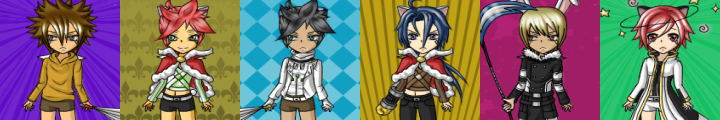
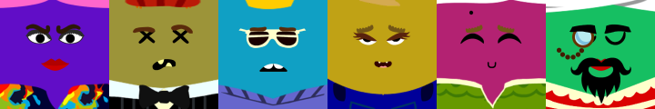
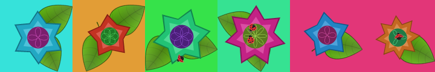
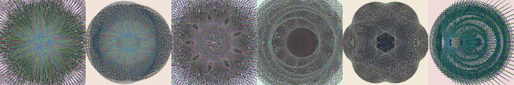
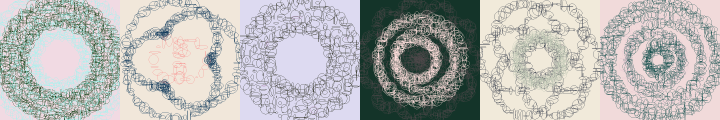
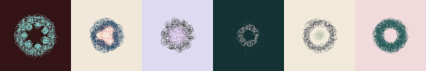
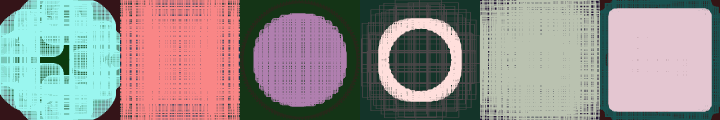
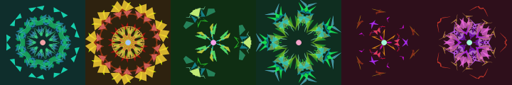

# Avatar models

Every model is deterministic: the hash is seeded into an MT19937 generator (`Rng`), and the builder draws its choices from it in a fixed order. Sample rows below are six hashes per model at 120px (`docs/samples/`).

There are two kinds of builder:

- **Layered** (`LayeredBuilder`): background colour, then one randomly chosen PNG per layer from `parts/<dir>/`. Counts are discovered from disk, so adding artwork changes the possible results without any code change. Dotfiles are ignored.
- **Procedural** (`SpirographBuilder`): drawn entirely with GD primitives.

## Active models

### anime

Layered, 12 layers bottom to top: Shadow (15), Base (8), Shirts (15), Pants (20), Shoes (14), Eyes (75), Mouth (2), Makeup (8), Headgear (4), Hair (66), Coats (12), Accessories (30). Parts are 200x300 and drawn scaled to 340x440 at (-50,-30), so the head and shoulders fill the 240x240 frame. Background is a random pastel. `anime/Frame` exists but was never used by the original builder and still isn't. Roughly 10^15 combinations.

### ragdoll

Layered: Shadow (2), Frame (2), HairBack (17), Base (2), Pants (2), Shirts (2), Accessories (26), Mouth (5), Nose (3), Eyes (9), Hair (14). Parts are 240x300 cropped to the top 240 rows.

### blockies

Layered, flat-colour cartoon face on a random pastel: pants/collar (35), freckles (7, 30% chance), eyes (30), eyebrows (14), mouth (21), moustache (17, 30% chance), head/hair (44). The face itself is the background colour. **The original builder is lost**; this layer order and the optional probabilities are new.

### flower

Hybrid: saturated background, one or two leaf parts (24 available), then a **drawn** star-petalled flower (5-8 points, three nested shades of one hue, with a rose-curve rosette centre in a contrasting hue), then a bug part (19 available, 60% chance). Flower radius 74-105px of 120 so it never reaches the edge. **The original builder is lost**; the flower drawing was reconstructed from a screenshot.

### spiro

Procedural. Two overlaid epicycle curves, `x = ra*cos(k*a) + rb*cos(k*b)`, `y` likewise with sin. The background is the complement of the art's dominant hue, dark behind light art and light behind dark art (all four spirograph types do this). Curve 1 is a dark solid line; curve 2 is a solid line whose hue steps through the colour wheel each segment. Parameters: a in [-20,20], b in [5,10], ra in [1,100], c in [1,10], d in [1,5], second radius in [1,50]. Curves end when they return within 2px of the start or after 6000 steps.

### arc

Same curve generator; each point is an ellipse outline (random 1-25px axes) instead of a line segment. The second curve uses a smaller outer radius (50).

### arcii

`arc` with a small footprint: first-radius range 1-20 and both curves at outer radius 50, giving a compact rosette. The original `arcii` called `imagearc` with misplaced arguments and drew off canvas; this keeps the intended look.

### boxy

Same curve generator with wider parameter ranges (a in [1,100], b in [-100,10], ra in [-50,50]) and rectangles between successive points instead of lines.

### kaleidoscope

Procedural, new (not part of the original service). Nine random translucent polygons are generated in one wedge of the circle, then rotated and mirrored around the centre into 5-10 segments, with a pale dot at the middle. Colours are an analogous palette around one base hue on a dark background.

### dunes

Procedural, new (not part of the original service). A vertical sky gradient with a glowing sun, then 4-6 layers of hills made from two summed sine waves each, fading from pale in the distance to dark in front. All colours come from one base hue.

## Adding a model

Layered: subclass `LayeredBuilder`, return a `Layer` list bottom to top (override `background()` or `place()` if needed), add parts under `parts/<dir>/`, register in `Avatar::__construct`. Procedural: add a preset to `SpirographBuilder`, or implement `Builder` directly.

## Artwork provenance

The original site credited the **anime** parts to Pikangie (deviantART) and the **ragdoll** parts to Ashley West; see [HISTORY.md](HISTORY.md). No licence terms for either survive, and nothing at all is recorded for the blockies and flower parts (no credits file; embedded image metadata was not checked). Confirm permission to redistribute the artwork before publishing this repository.
